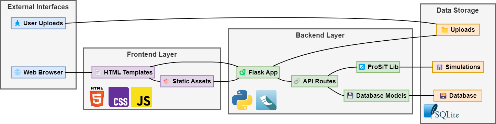

# ProSiT — PROcess SImulation Tool

[](https://github.com/franvinci/prosit-tool/actions/workflows/tests.yml)
[](#license)
[](https://www.python.org/downloads/)
[](https://pypi.org/project/prosit-pm/)


ProSiT is a web-based tool for **interactive and transparent business process simulation**. Given an event log (XES or CSV) and an optional Petri net process model, it discovers simulation parameters — arrival rates, execution and waiting times, resource assignments, routing probabilities, and case-level attributes — and lets users edit them through a graphical interface before running discrete-event simulations.

The tool is built on top of the [`prosit-pm`](https://pypi.org/project/prosit-pm/) Python library, which provides the underlying rule-aware simulation engine. ProSiT exposes the engine through a Flask web application that adds end-to-end workflow support: data ingestion, parameter discovery, scenario configuration, accuracy assessment against the original log, and visual analytics on the simulated traces.

Unlike opaque deep-learning simulators, ProSiT keeps every step — the discovered Decision Tree rules, the fitted distributions, the resource calendars — inspectable and editable. The same screen that shows a discovered parameter is the screen where the analyst can override it to design a what-if scenario.

---

## Table of Contents

- [Installation](#installation)
- [Quick Start](#quick-start)
- [Workflow](#workflow)
- [Input Format](#input-format)
- [Architecture](#architecture)
- [Project Structure](#project-structure)
- [API Endpoints](#api-endpoints)
- [Configuration](#configuration)
- [Security](#security)
- [Troubleshooting](#troubleshooting)
- [Upgrading from 1.0](#upgrading-from-10)
- [Development](#development)
- [Citation](#citation)
- [License](#license)

---

## Installation

ProSiT runs on your computer and is used from the browser. There are four ways to get it:

| | For | Needs |
|---|---|---|
| [The app](#option-1--the-app) | Anyone | Nothing |
| [pip, pipx or uv](#option-2--pip-pipx-or-uv) | Who already uses Python | Python 3.10, 3.11 or 3.12 |
| [Docker](#option-3--docker) | A server, or keeping it apart from the rest of the system | Docker |
| [From source](#option-4--from-source) | Development | Python 3.10, 3.11 or 3.12, git |

Whichever you choose, the tool is then at **http://localhost:5050** and nothing you upload leaves your computer.

### Option 1 — The app

Download the archive for your system from the [latest release](https://github.com/franvinci/prosit-tool/releases/latest), unpack it, and start the program inside:

| System | File | Start |
|---|---|---|
| Windows (64 bit) | `prosit-tool-<version>-windows-x86_64.zip` | Double-click `prosit-tool.exe` |
| macOS, Apple Silicon | `prosit-tool-<version>-macos-arm64.tar.gz` | Double-click `prosit-tool` |
| macOS, Intel | `prosit-tool-<version>-macos-x86_64.tar.gz` | Double-click `prosit-tool` |
| Linux (x86-64) | `prosit-tool-<version>-linux-x86_64.tar.gz` | `./prosit-tool` |

A window with some text opens: that is the program. A few seconds later the browser shows the tool. To stop it, close that window or press `Ctrl+C` in it.

The programs are not signed, so the first start needs a confirmation:

- **Windows.** If "Windows protected your PC" appears, choose *More info*, then *Run anyway*.
- **macOS.** macOS refuses to open what it has just downloaded and does not know. Once, in the Terminal: `xattr -dr com.apple.quarantine /path/to/the/unpacked/folder`, then double-click `prosit-tool`.

Good to know:

- Unpack the whole archive: the program needs the `_internal` folder that is next to it.
- Your data is kept in your user folder (see [Configuration](#configuration)), not in the unpacked one: replacing the folder with a newer version loses nothing.
- The Linux program is built on Ubuntu 22.04 and runs on distributions of that age or newer.

### Option 2 — pip, pipx or uv

With Python 3.10, 3.11 or 3.12 (the scientific libraries underneath do not support 3.13 yet), install the wheel published with each release. [uv](https://docs.astral.sh/uv/) and [pipx](https://pipx.pypa.io/) give the tool an environment of its own and put the `prosit-tool` command on your path:

```bash
uv tool install --python 3.12 https://github.com/franvinci/prosit-tool/releases/download/v1.1.0/prosit_tool-1.1.0-py3-none-any.whl
```

```bash
pipx install --python 3.12 https://github.com/franvinci/prosit-tool/releases/download/v1.1.0/prosit_tool-1.1.0-py3-none-any.whl
```

With plain `pip`, use a virtual environment so that the tool's dependencies do not mix with those of other projects, and give `pip install` the same address.

Then start it:

```bash
prosit-tool
```

The browser opens on the tool; `Ctrl+C` in the terminal stops it. `prosit-tool --help` lists the options.

`pip` can also install straight from the repository (`git+https://github.com/franvinci/prosit-tool@v1.1.0`), which downloads all of it, example logs included.

### Option 3 — Docker

```bash
docker run --rm -p 127.0.0.1:5050:5050 -v prosit-data:/data ghcr.io/franvinci/prosit-tool
```

The image is published for Intel/AMD and ARM processors. Uploaded logs, simulations and the database are kept in the `prosit-data` volume; `Ctrl+C` stops the container. Tags: `latest`, and one per release (`1.1.0`, `1.1`).

With Docker Compose, from a copy of this repository:

```bash
docker compose up -d      # start
docker compose down       # stop
```

The data is then kept next to `docker-compose.yml`, in `uploads/`, `simulations/` and `instance/`. `docker compose up -d --build` builds the image from the sources instead of downloading it.

Helper scripts that check Docker, start the tool and open the browser are under `installer/`:

| Platform | Setup | Run | Stop |
|---|---|---|---|
| Windows | `installer\windows\setup-windows.bat` | `installer\windows\run-docker.bat` | `installer\windows\stop-docker.bat` |
| Ubuntu / Linux | `installer/ubuntu/setup-ubuntu.sh` | `installer/ubuntu/run-docker.sh` | `installer/ubuntu/stop-docker.sh` |
| macOS | `installer/macos/setup-macos.sh` | `installer/macos/run-docker.sh` | `installer/macos/stop-docker.sh` |

### Option 4 — From source

```bash
git clone https://github.com/franvinci/prosit-tool
cd prosit-tool

python -m venv .venv
source .venv/bin/activate        # Windows: .venv\Scripts\activate
pip install -e .

python main.py
```

Started this way, the tool keeps its data inside the checkout (`uploads/`, `simulations/`, `instance/`). A conda environment works too: `conda env create -f environment.yml`.

### Dependencies

Nothing has to be installed besides Python packages — in particular no Graphviz: diagrams are drawn by the browser.

| Package | Purpose |
|---|---|
| `prosit-pm` 1.0.5 | Core simulation engine (parameter discovery + discrete-event simulation) |
| `pm4py` 2.7 | Event log parsing, Petri net discovery and conformance |
| `flask` 3.1, `flask-sqlalchemy` 3.1 | Web application and session persistence (SQLite by default) |
| `waitress` 3 | Web server (runs on Windows, macOS and Linux) |
| `scikit-learn`, `river` | Decision tree models: batch and incremental discovery |
| `scipy`, `pandas`, `numpy` | Distribution fitting and sampling, data handling |
| `log-distance-measures` 2 | Accuracy metrics between real and simulated logs |
| `platformdirs` 4 | Location of the per-user data directory |

`pyproject.toml` states the versions the tool accepts; `packaging/constraints.txt` lists the exact ones each release is tested with and built from.

---

## Quick Start

After starting the application:

1. Open `http://localhost:5050` in a browser (the app and the `prosit-tool` command open it for you).
2. Choose an event log. XES is supported natively; for CSV, map its columns (case ID, activity, end timestamp, optional start timestamp and resource).
3. Optionally provide your own Petri net in PNML format. Otherwise, the Inductive Miner discovers one from the log.
4. Set the discovery options (noise threshold, decision tree depth and, under *Advanced*, multitasking, workload features, attribute mode) and press **Upload & Discover**. A progress bar shows which step the discovery is at and how far it is.
5. Inspect and edit the discovered parameters in the tabs under the process model: transition weights, resources, arrival, execution and waiting times, trace attributes. Clicking a transition of the Petri net opens its weight.
6. (Optional) Create one or more **what-if scenarios** as variants of the baseline.
7. Run the simulation, choosing the number of traces and the starting timestamp.
8. Compare the simulated log against the real log via accuracy metrics, and inspect the generated process maps, cycle-time distributions, resource heatmaps, and waiting-time analyses.
9. Download the simulated log as CSV or XES.

The example logs under `example_data/` (`purchasing.xes`, `bpi12.xes`, `bpi17_march.xes`, `synloan.xes`, `onboard_client.xes`, `purchasing.csv`) can be used to try the workflow end-to-end without any preparation.

---

## Workflow

ProSiT supports an end-to-end pipeline organised in five phases.

### 1. Data Ingestion

- **Event Log Upload.** Accepts XES or CSV. CSV requires a column mapping; XES is read with `pm4py` directly.
- **Process Model Import.** Optionally provide a Petri net in PNML format. Otherwise, ProSiT applies the Inductive Miner with the chosen noise threshold.
- **Validation.** The uploaded log must contain a case identifier, an activity name, and a completion timestamp. A start timestamp and a resource column are optional but recommended — the tool falls back to defaults (start = end timestamp, a single resource named `unknown`) when absent, and says so after the discovery.

### 2. Parameter Discovery

ProSiT delegates the actual learning to the `prosit-pm` library. The web interface exposes the most relevant knobs:

| Setting | Default | Effect |
|---|---|---|
| **Noise threshold** | `0.2` | Inductive Miner filtering threshold (range 0–1) |
| **Decision tree max depth** | `0` | `0` disables rules (pure distributions); higher values produce richer per-leaf models. CV selects the best depth up to the chosen ceiling |
| **Incremental discovery** | off | When on, uses Hoeffding Adaptive Trees from `river` (gives more weight to recent traces) |
| **Grace period** | `1000` | (Incremental only) observations before the tree considers splitting a node |
| **Discover multitasking** | off | Lets a resource work on several tasks at once when the log shows that it does |
| **Multitasking threshold** | `0.05` | Minimum fraction of concurrent events for a resource to be considered multitasking |
| **Random state** | `72` | Controls reproducibility |
| **Workload features** | off | Lets decision trees also test how busy the resources are and how long their queues |
| **Attribute mode** | `distribution` | Independent per-attribute distributions, or `empirical` for joint sampling (preserves correlations) |
| **Compute evaluation** | off | Also simulates the log as it is and measures how close the simulation gets (see phase 4). Can take a few minutes |

While the discovery runs, a progress bar shows the step in progress (reading the log, discovering the model, measuring its fitness and precision, then each step of `prosit-pm`), the percentage, and what the step is counting.

What ProSiT discovers from the log:

| Parameter | What it models |
|---|---|
| Arrival time | Inter-arrival time between consecutive cases, conditional on hour and weekday |
| Execution time | Working-hours duration of each activity, conditional on resource and case context |
| Waiting time | Queue delay after a resource becomes free, conditional on workload and case context |
| Control flow | Routing probability at each decision point, conditional on case history |
| Resource selection | Per (activity, candidate resource) classifier conditional on resource-usage history and case attributes |
| Calendars | Working hours per resource and for case arrivals |
| Multitasking | Maximum concurrent tasks per resource |
| Data attributes | Joint or per-attribute distribution of case-level data attributes |

### 3. Interactive Scenario Configuration

Every discovered parameter is editable in the UI:

- **Control flow.** Adjust transition weights at each decision point. The Petri net is interactive: clicking a transition selects it and opens its weight; choosing one from the list highlights it in the net.
- **Resource matrix.** Toggle which resources can perform which activities, edit per-resource weights and capacity.
- **Calendars.** Edit weekday/hour availability per resource and for case arrivals.
- **Time distributions.** Inspect each fitted distribution (or per-leaf distribution when rules are active) and override its parameters.
- **Case attributes.** Inspect and modify the discovered attribute distribution.

Edits can be saved as **what-if scenarios** alongside the baseline (As-Is) configuration. Each scenario is an independent simulation and can be compared against the others. The baseline itself is never changed: editing it and running a simulation creates a new scenario.

### 4. Accuracy Assessment

The tool evaluates simulation quality by comparing the simulated log against the original event data using:

- **Control-flow similarity.** N-gram distance between case sequences.
- **Temporal accuracy.** Distributional metrics for arrival, execution, and waiting times.
- **Resource behaviour.** Realism of resource handover patterns.
- **Cycle time.** Distance between empirical cycle-time distributions.

Metrics are computed via the [`log-distance-measures`](https://pypi.org/project/log-distance-measures/) library on the baseline scenario.

### 5. Simulation Execution

- **Configuration.** Number of traces (1–10,000) and starting timestamp.
- **Execution.** Discrete-event simulation runs server-side.
- **Visual analytics.** Process maps annotated with frequency or performance, cycle-time histograms, resource utilisation heatmaps, per-activity execution and waiting-time distributions, and side-by-side comparisons between the real and simulated logs.
- **Export.** The simulated log is downloadable as XES or CSV. The parameters of every scenario are kept in the data directory (`uploads/*_parameters*.json`) in the JSON format that `prosit-pm` reads.

---

## Input Format

### XES

XES files are read directly with `pm4py`. The default attribute names are expected: `case:concept:name`, `concept:name`, `time:timestamp`, optionally `start:timestamp` and `org:resource`. If your XES uses different attribute names, you can provide a mapping at upload time.

### CSV

CSV uploads always require a mapping form with at least:

- **Case ID column** — unique identifier of each case.
- **Activity column** — name of the activity.
- **End timestamp column** — completion time of the event.

Optional fields:

- **Start timestamp column** — defaults to the end timestamp if not provided.
- **Resource column** — defaults to `unknown` if not provided.

Timestamps must be parseable by `pandas.to_datetime` (ISO 8601 is the safest choice). The CSV is converted to XES on the server before discovery starts.

### PNML

The optional Petri net file is read with `pm4py.read_pnml`. When provided, ProSiT skips the Inductive Miner step and uses the supplied net directly.

The labels of its transitions have to be the activity names of the log, written the same way: the parameters are learnt by replaying the log on the net. Events of activities that the net does not have cannot be replayed and are left out (the tool lists those activities after the discovery); a net that has none of the activities of the log is refused.

---

## Architecture

ProSiT is a Flask application with a thin server-side template layer and a JavaScript frontend that drives all interactive parameter editing. State is persisted per session in SQLite via SQLAlchemy. The simulation engine itself is the `prosit-pm` library, invoked through `prosit_tool/prosit_integration.py`.



The integration layer (`prosit_integration.py`, `format_converters.py`) is responsible for translating between the JSON shape the UI exchanges with the browser and the typed objects (`SimulatorParameters`) consumed by `prosit-pm`. This split keeps the UI free of any direct dependency on the engine internals.

The server describes the Petri net and the process maps as text (`petri_dot.py`); the page draws them with Graphviz compiled to WebAssembly. Like every other library of the page, it is part of the package (`static/vendor`): the tool needs no network connection.

---

## Project Structure

```
prosit-tool/
├── prosit_tool/                # The installable package
│   ├── app.py                  # Application factory: create_app()
│   ├── cli.py                  # `prosit-tool` command (server + browser)
│   ├── config.py               # Constants, data directory, secret key
│   ├── extensions.py           # SQLAlchemy instance
│   ├── models.py               # SQLAlchemy models (SimulationSession, SimulationRun)
│   ├── validators.py           # Request input validators
│   ├── api/                    # Flask blueprints
│   │   ├── upload.py           # XES/CSV/PNML upload + column mapping
│   │   ├── discovery.py        # Petri net + parameter discovery, and its progress
│   │   ├── parameters.py       # Parameters of a session; storing what the UI edits
│   │   ├── simulation.py       # Simulation execution and downloads
│   │   ├── runs.py             # Sessions and what-if scenarios
│   │   ├── visualization.py    # Charts and process map of a simulated log
│   │   ├── system.py           # Health check
│   │   ├── errors.py           # JSON error handlers
│   │   ├── _shared.py          # Cross-blueprint helpers
│   │   └── _decorators.py      # @handle_api_errors decorator
│   ├── prosit_integration.py   # prosit-pm integration layer
│   ├── format_converters.py    # UI <-> prosit-pm distribution conversions
│   ├── petri_dot.py            # Description of a Petri net for the page to draw
│   ├── progress.py             # How far a long operation has got
│   ├── workers.py              # Processes that fit the models when the tool is the app
│   ├── worker_process.py       # What one of those processes runs
│   ├── evaluation.py           # Accuracy metrics (real vs simulated)
│   ├── templates/              # Jinja templates
│   └── static/                 # CSS, JavaScript (ES modules under js/, no build step)
│       └── vendor/             # and the third-party libraries of the page
├── main.py                     # Run from a checkout, keeping data in the checkout
├── pyproject.toml              # Package metadata, dependencies, entry point
├── packaging/                  # Tested versions, executable recipe, notices, smoke test
├── .github/workflows/          # Tests on every push; builds of a release
├── installer/                  # Platform-specific Docker helper scripts
├── example_data/               # Sample XES/CSV logs
├── tests/                      # Pytest suite; JavaScript unit tests under js/
├── docker-compose.yml          # Docker Compose configuration
├── Dockerfile                  # Image definition
├── environment.yml             # Conda environment (installs the package in editable mode)
├── LICENSE                     # MIT License
├── THIRD-PARTY-LICENSES        # Licences of the software by other authors that comes with the tool
└── README.md                   # This documentation
```

---

## API Endpoints

The HTTP API is what the in-browser frontend uses; it is also usable directly for scripted workflows.

| Method | Path | Purpose |
|---|---|---|
| `GET` | `/` | Main application interface |
| `GET` | `/api/health` | Application name and version (used to detect a running instance) |
| `POST` | `/api/upload` | Upload XES or CSV log (and optional PNML); creates a session |
| `POST` | `/api/discover/<session_id>` | Run discovery (Petri net + parameters) |
| `GET` | `/api/discover/<session_id>/progress` | How far the running discovery has got: percentage, step in progress, what it is counting |
| `GET` | `/api/parameters/<session_id>` | Load discovered parameters for a session |
| `POST` | `/api/simulate/<session_id>` | Run a simulation for the baseline scenario |
| `POST` | `/api/metrics/<session_id>` | Compute accuracy metrics (real vs simulated) |
| `GET` | `/api/sessions` | List the most recent sessions |
| `GET` | `/api/sessions/<session_id>/runs` | List the scenarios of a session |
| `POST` | `/api/sessions/<session_id>/runs` | Create a new what-if scenario |
| `GET` | `/api/runs/<run_id>` | Load parameters of a specific scenario |
| `PUT` | `/api/runs/<run_id>` | Replace parameters of a scenario |
| `PATCH` | `/api/runs/<run_id>` | Patch scenario metadata |
| `POST` | `/api/runs/<run_id>/simulate` | Run the simulation for a specific scenario |
| `DELETE` | `/api/runs/<run_id>` | Delete a scenario |
| `PATCH` | `/api/sessions/<session_id>` | Update session metadata |
| `DELETE` | `/api/sessions/<session_id>` | Delete a session |
| `GET` | `/api/download/<filename>` | Download a generated CSV |
| `GET` | `/api/download_xes/<filename>` | Download a generated log as XES |
| `GET` | `/api/get_activities_and_resources/<session_id>` | List activities/resources from the simulated log |
| `GET` | `/api/get_visualization/<session_id>/<visualization_type>` | Data of a chart, or description of the process map, from the simulated log |

Errors are JSON (`{"error": "..."}`) with a 4xx or 5xx status.

---

## Configuration

### Command-line options

```
prosit-tool [--host HOST] [--port PORT] [--data-dir DIR] [--no-browser] [--version]
```

`python main.py` accepts the same options and keeps the data inside the checkout. The executable of [the app](#option-1--the-app) accepts them too.

When port 5050 is taken by another program, the next free one is used and shown at start-up; when it is taken by a ProSiT that is already running, that one is opened instead of starting a second.

### Environment variables

| Variable | Default | Purpose |
|---|---|---|
| `PROSIT_TOOL_DATA_DIR` | per-user data directory | Where uploads, simulation logs and the database are kept |
| `PROSIT_TOOL_HOST` | `127.0.0.1` | Address to listen on. The default accepts connections from this computer only; use `0.0.0.0` to accept them from the network (see [Security](#security)) |
| `PROSIT_TOOL_PORT` | `5050` | Port to listen on (`FLASK_PORT` is still accepted). Without it, the next free port is used when 5050 is taken |
| `PROSIT_TOOL_NO_BROWSER` | unset | Set to `1` to not open the browser at start-up |
| `DATABASE_URL` | SQLite file in the data directory | SQLAlchemy connection string |
| `SESSION_SECRET` | generated on first start | Secret key for Flask. Optional: when unset, a random key is created once and stored in the data directory |

### Where the data is

| Installed as | Data directory |
|---|---|
| App, pip, pipx, uv | Linux: `~/.local/share/prosit-tool` · macOS: `~/Library/Application Support/prosit-tool` · Windows: `%LOCALAPPDATA%\prosit-tool` |
| Docker image | `/data` in the container: mount a volume there |
| Docker Compose | `uploads/`, `simulations/` and `instance/`, next to `docker-compose.yml` |
| `python main.py` | The checkout |

It contains `uploads/` (event logs, Petri nets, parameters), `simulations/` (simulated logs) and `instance/prosit.db` (sessions and scenarios). `--data-dir` or `PROSIT_TOOL_DATA_DIR` moves it. To back it up, copy the directory while the tool is stopped.

During a discovery, tables with what was read from the log are also written to temporary files (in the temporary directory of the system or, on Linux, in `/dev/shm`), which the processes that fit the models share. They are removed when the discovery ends.

### Constants

Other defaults (discovery thresholds, simulation bounds, maximum upload size of 100 MB) are defined in `prosit_tool/config.py`. Edit the `Config` class to change them.

### Database

SQLite is used by default; any SQLAlchemy-supported database can be plugged in by changing `DATABASE_URL`. A connection pool with a 300-second recycle is configured, suitable for hosted PostgreSQL or MySQL.

---

## Security

ProSiT is made to be used by one person on their own computer. **It has no user accounts and no password**: whoever can reach it can read every uploaded log, change every scenario and delete every session.

- By default it listens on this computer only (`127.0.0.1`), and so do the Docker commands above (`-p 127.0.0.1:5050:5050`).
- To use it from other computers of a network you trust, start it with `--host 0.0.0.0` or, with Docker Compose, change the port to `"5050:5050"` in `docker-compose.yml`.
- Do not expose it to the internet as it is. If it has to be reachable from outside, put it behind a reverse proxy that asks for a password and uses HTTPS.
- Uploaded logs are stored as they are in the data directory. Deleting a session in the tool deletes its files.

---

## Troubleshooting

### The app

- **Nothing seems to happen at the first start.** The window shows "Starting ProSiT..." until the tool is ready. The first start can take longer than the following ones, especially when an antivirus program checks the files of the folder.
- **The window shows an error (Windows).** It stays open so that the message can be read: it says what is wrong (for example, a data folder that cannot be written).
- **"prosit-tool is damaged" or "cannot be opened" (macOS).** Run the `xattr` command of [Option 1](#option-1--the-app) on the unpacked folder.
- **The browser does not open.** Open the address that the window shows (usually `http://localhost:5050`).
- **"The models were fitted by one process".** The app could not start the processes it fits the models with; the note gives the reason (an antivirus program that blocks them, for example). What was discovered is complete: it only took longer.

### Docker

- **Docker not starting.** Ensure Docker Desktop is running. On Windows/Linux, verify that virtualisation is enabled in BIOS. On macOS, wait for the whale icon to settle in the menu bar.
- **`docker compose` is not a command.** It comes with current versions of Docker; the old separate `docker-compose` program is not used any more. Update Docker Desktop, or install the `docker-compose-plugin` package on Linux.
- **Port 5050 already in use.** Change the first number of the `ports` mapping in `docker-compose.yml`, or of `-p` in the `docker run` command.
- **Files in `uploads/` belong to root (Linux).** The container runs as root. To have it run as you, add `user: "1000:1000"` (your user and group ids, as printed by `id`) to the service in `docker-compose.yml`; the three data folders must then already exist and belong to you.

### Application

- **"The Petri net cannot be used with this event log".** The net and the log have no activity in common: the PNML file belongs to another process, or names the activities differently. The message lists the activities of both.
- **The discovery takes long.** The progress bar says which step it is at. On logs with thousands of variants most of the time goes into aligning the log with the model (fitness, precision, replay); decision trees add the fitting of the models.
- **A discovery slows the computer down, or runs out of memory.** The models are fitted on all the processor cores but one, each by a process of its own. To use fewer, set the environment variable `LOKY_MAX_CPU_COUNT` before starting the tool: with `LOKY_MAX_CPU_COUNT=4` three processes fit the models, with `1` a single one does.
- **Memory issues during simulation.** Increase Docker memory allocation, or reduce the number of cases / decision tree depth.
- **File upload errors.** Check that the file is under 100 MB and that the format is XES or CSV. For CSV, ensure the column mapping is provided.
- **CSV `time` parsing errors.** Timestamps must be parseable by `pandas.to_datetime`. Prefer ISO 8601.

### Logs

- The app, `prosit-tool` and `python main.py` write what they do in the window or terminal they run in.
- Docker: `docker compose logs -f`; container status: `docker compose ps`; restart: `docker compose restart`.

---

## Upgrading from 1.0

- **Your sessions.** A checkout started with `python main.py`, and Docker Compose, keep using the same `uploads/`, `simulations/` and `instance/` folders: sessions made with 1.0 open as they are. The installed `prosit-tool` command keeps its data in the per-user directory instead; point it at the old folder with `prosit-tool --data-dir /path/to/the/old/checkout`.
- **Scenarios saved with 1.0.** Version 1.0 altered uniform and exponential distributions whenever a scenario was saved, and applied in reverse the conditions on a category that were added to a decision tree by hand. 1.1 neither repairs nor hides this: such scenarios are shown as they are stored. Create them again from the baseline if they matter.
- **Discovering again.** `prosit-pm` 1.0.5 selects the time models differently from 1.0.2: a new discovery of the same log can give slightly different values.
- **Start-up.** `SESSION_SECRET` is no longer required, Graphviz no longer has to be installed, and the server listens on this computer only unless told otherwise.
- **Docker.** The image is built with pip alone and keeps its data in `/data`. The port is published on this computer only. The scripts use `docker compose`.
- **API.** `process_model` now carries `dot` and `nodes` (the description of the net, drawn by the page) instead of `visualization` and `map_transitionName_to_id`; the process map answers `dot` as well. `PUT /api/parameters/<session_id>` is gone: parameters are stored per scenario, with `PUT /api/runs/<run_id>`.

---

## Development

```bash
git clone https://github.com/franvinci/prosit-tool
cd prosit-tool
python -m venv .venv && source .venv/bin/activate

# The tool in editable mode, with the versions of the dependencies that are tested
pip install -c packaging/constraints.txt -e ".[dev]"

# Run the test suite
pytest

# Run from the checkout (data stays in ./uploads, ./simulations, ./instance)
python main.py

# Same, with Flask's debugger and auto-reload
PROSIT_TOOL_DATA_DIR=. flask --app prosit_tool.app run --debug --port 5050
```

Tests live under `tests/` and cover smoke, security, and unit-level behaviour. The pytest configuration is in `pytest.ini`. They run on every push (`.github/workflows/tests.yml`) on Python 3.10, 3.11 and 3.12.

The page's JavaScript is plain ES modules served as they are (`prosit_tool/static/js`, entry point `app.js`): there is nothing to build or install. Its unit tests are in `tests/js` and run with Node.js 20.19 or later, with no dependencies:

```bash
node --test tests/js/*.test.mjs
```

`pytest` runs them too when Node.js is available, together with checks that every module imports names that exist and that every button of the page names an action that is handled.

### Releasing

Set the version in `prosit_tool/__init__.py` (and in the two install commands of this file), commit, then push a tag with the same number:

```bash
git tag v1.1.0
git push origin v1.1.0
```

`.github/workflows/release.yml` then runs the tests, builds the wheel, the executables for the four systems and the Docker image, tries each of them through a whole session (`packaging/smoke_test.py`), and only if everything works publishes the image and a GitHub Release with all the files. [`packaging/README.md`](packaging/README.md) describes every step and how to run it by hand.

To get the executables of a commit without releasing it, push it to a branch whose name begins with `trial/` (`git push origin HEAD:trial/1.1.0`): the same workflow builds and tries everything, publishes nothing, and leaves the files among the artifacts of the run.

---

## Citation

Version [v0.1.0](https://github.com/franvinci/prosit-tool/releases/tag/v0.1.0) of ProSiT corresponds to the implementation presented in the following paper. Please cite it if you use the tool in academic work:

> Vinci, F., Park, G., van der Aalst, W. M. P., de Leoni, M. (2026). ProSiT: A Tool for Interactive and Transparent Process Simulations. In: *Proceedings of the International Conference on Service Oriented Computing (ICSOC): Demonstrations and Resources*. Lecture Notes in Computer Science, Springer.

BibTeX:

```bibtex
@inproceedings{VinciProSiT2026,
  author    = {Francesco Vinci and Gyunam Park and Wil M. P. van der Aalst and Massimiliano de Leoni},
  title     = {{ProSiT}: A Tool for Interactive and Transparent Process Simulations},
  booktitle = {Proceedings of the International Conference on Service Oriented Computing (ICSOC): Demonstrations and Resources},
  year      = {2026},
  publisher = {Springer},
  series    = {Lecture Notes in Computer Science}
}
```

The underlying simulation engine is described in:

> Vinci, F., Park, G., van der Aalst, W. M. P., de Leoni, M. (2026). Reliable and Configurable Process Simulations via Probabilistic White-Box Models. In: *Service-Oriented Computing — ICSOC 2025*. Lecture Notes in Computer Science, vol 16321. Springer, Singapore. https://doi.org/10.1007/978-981-95-5015-9_24

---

## License

ProSiT Tool is released under the MIT License — see [LICENSE](LICENSE).

It comes with software by other authors, each under its own licence:

- The libraries of the page (Bootstrap, Chart.js, Feather, Viz.js with Graphviz) are part of the repository and of the pip package. [THIRD-PARTY-LICENSES](THIRD-PARTY-LICENSES) names them and reproduces their licences.
- The app and the Docker image also contain Python and every package the tool depends on. Two of them, `pm4py` and `cvxopt`, are under the GNU Affero General Public License and the GNU General Public License, so **the app and the Docker image as a whole are distributed under the GNU AGPL, version 3 or later**. Each contains a `THIRD-PARTY-NOTICES.txt` that lists every component; the source of those two packages is attached to every release, next to the source of the tool.

Installed with pip, the tool is MIT and its dependencies are downloaded by pip from their own authors.
